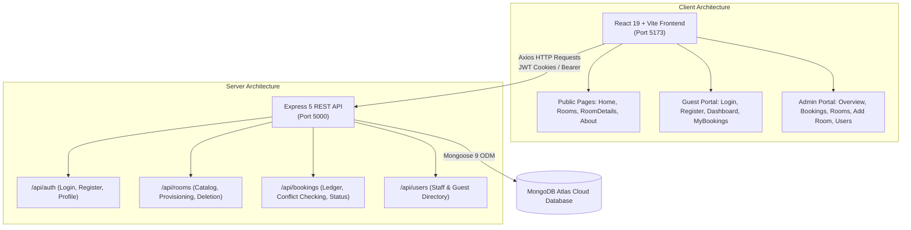

# HotelPro — Luxury Hospitality Management & Reservation System

[](https://react.dev/)
[](https://nodejs.org/)
[](https://www.mongodb.com/atlas)
[](https://vitejs.dev/)
[](https://getbootstrap.com/)
[](LICENSE)

A full-stack, production-quality MERN hotel reservation and central administration platform crafted for boutique hotels, luxury resorts, and hospitality operators. Built with real-time MongoDB Atlas synchronization, role-based authorization, date-conflict booking prevention, and a tailored bespoke luxury design system.

---

## Table of Contents
- [Executive Overview](#executive-overview)
- [Demo Access & Credentials](#demo-access--credentials)
- [System Architecture](#system-architecture)
- [Frontend Engineering](#frontend-engineering)
- [Backend Engineering](#backend-engineering)
- [Database Schema & Data Models](#database-schema--data-models)
- [REST API Specification](#rest-api-specification)
- [Installation & Quick Start](#installation--quick-start)
- [Database Seeding](#database-seeding)
- [Production Build & Quality Assurance](#production-build--quality-assurance)

---

## Executive Overview

HotelPro combines a public-facing luxury booking portal with a comprehensive Central Command Admin Dashboard. The system replaces static or mocked UI components with end-to-end connected MongoDB Atlas database transactions, ensuring that room inventory, guest reservations, revenue metrics, and user roles are always synchronized live.

### Key Capabilities
- **Live Atlas Central Command**: 7 real-time operations KPI cards calculating catalog count, available inventory, occupancy percentages, reservation counts, cancellation ratios, registered guests, and gross booking revenue.
- **Reservations Ledger**: Searchable, status-filtered, and date-sorted bookings management with real-time status transitions and printable luxury guest invoice receipts.
- **Suite Provisioning Engine (`/admin/add-room`)**: 4-module structured room creator featuring 1-click curated luxury presets, interactive signature amenity toggle pills, live image URL asset validation with a thumbnail preview strip, and a sticky real-time Guest Card Simulator.
- **Accommodations Inventory Management**: Multi-view accommodations catalog (Card Grid vs. Table Ledger) with instant availability toggles and safety deletion modals.
- **Double-Booking Prevention**: Date-overlap algorithm strictly blocks duplicate reservations for identical dates and units.
- **Bespoke Luxury Design Language**: Dark navy (`#0A1424`), royal sapphire (`#12233D`), warm champagne gold (`#D4AF37`), and ivory background (`#FAF9F5`) with glassmorphism and subtle micro-interactions.

---

## Demo Access & Credentials

The platform is pre-seeded with active accounts and sample reservations for testing both guest and administrative workflows:

| Portal | Role | URL | Email | Password | Features |
| :--- | :--- | :--- | :--- | :--- | :--- |
| **Admin Central Command** | Administrator | [`/admin/login`](http://localhost:5173/admin/login) | `admin@hotelpro.com` | `admin123` | KPI Cards, Bookings Ledger, Room Provisioning, User Directory |
| **Guest Booking Portal** | Registered Guest | [`/login`](http://localhost:5173/login) | `guest@hotelpro.com` | `guest123` | Browsing, Reservation Engine, Guest Dashboard (`/dashboard`) |

> Both login interfaces feature **1-click Auto-fill** buttons to populate demo credentials instantly.

---

## System Architecture



---

## Frontend Engineering

Located in `client/`, built with modern React 19, Vite 8, React-Bootstrap, Lucide Icons, and Vanilla CSS tokens.

### Route & Page Hierarchy
- **Public & Guest Browsing**:
  - `/` — Luxury hotel hero, featured suites showcase, experience highlights, and footer.
  - `/rooms` — Public suite catalog with category filtering, capacity indicators, and nightly rates.
  - `/rooms/:id` — Suite presentation with photo gallery, amenities checklist, and reservation form.
  - `/about` — Heritage, resort philosophy, and guest services information.
- **Guest Account**:
  - `/login` — Guest sign-in with 1-click demo guest auto-fill.
  - `/register` — New guest registration with name, email, phone, and password.
  - `/dashboard` & `/my-bookings` — Guest reservation tracking, check-in dates, status badges, and booking cancellation.
- **Admin Central Command (`/admin`)**:
  - `/admin/login` — Dedicated staff portal gateway with 1-click admin auto-fill.
  - `/admin/overview` — 7 Live KPI metric cards synced with MongoDB Atlas.
  - `/admin/bookings` — Full ledger with live search, status filter (`all`, `confirmed`, `pending`, `cancelled`), date sorting, status adjustment modal, and printable invoice generator.
  - `/admin/rooms` — Inventory catalog with grid/table toggle, maintenance toggles, and deletion controls.
  - `/admin/add-room` — Suite provisioning studio with 1-click presets, signature amenity pills, live image thumbnail strip, and sticky guest card preview.
  - `/admin/users` — Staff & guest directory with search, role indicators, and administrator privilege toggles.

### Luxury Design System (`client/src/index.css`)
- **Color Tokens**:
  - Primary Navy: `#0A1424` / `#12233D`
  - Accent Gold: `#D4AF37` / `#B89628`
  - Warm Ivory Background: `#FAF9F5` / `#F8FAFC`
- **Component Classes**:
  - `.card-luxury`: 20px border radius, subtle border, multi-tier box-shadow.
  - `.admin-form-card`: 24px border radius, 40px padding, clean section dividers.
  - `.amenity-pill-btn`: Click-to-toggle amenity pills with gold checkmarks and gradient active state.
  - `.preview-card-showcase`: Sticky guest card simulator with glassmorphic price badge and gradient contrast overlay.
  - `.admin-stat-card`: Color-accented top border, metric counter, and icon container.

---

## Backend Engineering

Located in `server/`, built on Express 5, Node.js, and Mongoose 9.

### Key Components
- **`server/index.js` & `server/app.js`**: Application entry point with robust `.env` path resolution (`path.join(__dirname, '.env')`), CORS credentials handling, cookie-parser, and JSON body parsing.
- **Authentication & Middleware**:
  - `middleware/authMiddleware.js`: Validates JWT stored in HTTP-only cookies or `Authorization: Bearer <token>` headers.
  - Role Verification: Rejects unauthorized access with `403 Forbidden` if non-admin requests admin endpoints.
- **Booking Conflict Engine (`controllers/bookingController.js`)**:
  - Checks date overlap using `$lt` / `$gt` logic:
    ```javascript
    checkInDate < existingCheckOutDate && checkOutDate > existingCheckInDate
    ```
  - Excludes cancelled reservations from conflict detection, guaranteeing that re-bookings for cancelled dates succeed without false conflicts.

---

## Database Schema & Data Models

Connected to MongoDB Atlas via Mongoose 9.

### 1. `User` Model (`server/models/User.js`)
| Field | Type | Attributes | Description |
| :--- | :--- | :--- | :--- |
| `name` | String | Required, Trimmed | Full name of the user or staff member |
| `email` | String | Required, Unique, Lowercase | Validated email address |
| `passwordHash` | String | Required | Bcrypt salted hash (10 rounds) |
| `role` | String | Enum: `guest`, `admin` | System role (default: `guest`) |
| `isAdmin` | Boolean | Default: `false` | Synchronized with role in pre-save hook |
| `phone` | String | Trimmed | Contact telephone number |

### 2. `Room` Model (`server/models/Room.js`)
| Field | Type | Attributes | Description |
| :--- | :--- | :--- | :--- |
| `name` | String | Required, Trimmed | Name/Identifier of the suite (e.g. "Grand Horizon Penthouse") |
| `roomType` | String | Required | Category tier (Deluxe Suite, Executive Suite, Ocean Villa, etc.) |
| `description` | String | Required | Detailed narrative and architectural description |
| `pricePerNight` | Number | Required, Min: 0 | Nightly rate in USD |
| `capacity` | Number | Required, Min: 1 | Maximum guest capacity |
| `status` | String | Enum: `available`, `maintenance` | Operational availability (default: `available`) |
| `amenities` | [String] | Array | Array of amenity strings (e.g. "Ocean View", "King Bed") |
| `images` | [String] | Array | Array of high-resolution image URLs (first is cover) |

### 3. `Booking` Model (`server/models/Booking.js`)
| Field | Type | Attributes | Description |
| :--- | :--- | :--- | :--- |
| `bookingReference` | String | Required, Unique, Uppercase | Auto-generated reference code (e.g. `BK-MVEBDJU2-GST`) |
| `user` | ObjectId | Ref: `User`, Required | Associated guest account ID |
| `room` | ObjectId | Ref: `Room`, Required | Reserved suite inventory ID |
| `checkInDate` | Date | Required | Guest arrival date |
| `checkOutDate` | Date | Required | Guest departure date |
| `guestCount` | Number | Required, Min: 1 | Number of staying guests |
| `numberOfNights` | Number | Required, Min: 1 | Duration of stay |
| `totalPrice` / `totalAmount` | Number | Required, Min: 0 | Total reservation price calculated from rate × nights |
| `status` / `bookingStatus` | String | Enum: `confirmed`, `pending`, `cancelled` | Current booking state |
| `paymentStatus` | String | Enum: `unpaid`, `paid`, `refunded` | Payment status |

---

## REST API Specification

### Authentication (`/api/auth`)
| Method | Endpoint | Access | Description |
| :--- | :--- | :--- | :--- |
| `POST` | `/api/auth/register` | Public | Register new guest account and receive JWT |
| `POST` | `/api/auth/login` | Public | Authenticate credentials; sets HTTP-only cookie + returns JWT |
| `POST` | `/api/auth/logout` | Public | Clears authentication cookie |
| `GET` | `/api/auth/profile` | Authenticated | Retrieve authenticated user profile |
| `PUT` | `/api/auth/profile` | Authenticated | Update user name, email, or contact details |

### Accommodations (`/api/rooms`)
| Method | Endpoint | Access | Description |
| :--- | :--- | :--- | :--- |
| `GET` | `/api/rooms` | Public | Fetch all suites (supports query filtering) |
| `GET` | `/api/rooms/:id` | Public | Fetch specific suite specifications by ID |
| `POST` | `/api/rooms` | Admin Only | Provision a new suite to the inventory |
| `PUT` | `/api/rooms/:id` | Admin Only | Update suite details, price, status, or amenities |
| `DELETE` | `/api/rooms/:id` | Admin Only | Remove suite from catalog |

### Bookings (`/api/bookings`)
| Method | Endpoint | Access | Description |
| :--- | :--- | :--- | :--- |
| `POST` | `/api/bookings` | Authenticated | Create reservation with automatic conflict verification |
| `GET` | `/api/bookings/my-bookings`| Authenticated | Get current logged-in guest's reservations |
| `GET` | `/api/bookings` | Admin Only | Fetch full booking ledger with populated user and room data |
| `GET` | `/api/bookings/:id` | Authenticated | Get single booking receipt details |
| `PUT` | `/api/bookings/:id/status` | Admin Only | Update status (`confirmed`, `pending`, `cancelled`) |
| `DELETE` | `/api/bookings/:id` | Authenticated | Cancel an existing reservation |

### Users Directory (`/api/users`)
| Method | Endpoint | Access | Description |
| :--- | :--- | :--- | :--- |
| `GET` | `/api/users` | Admin Only | Fetch list of registered guests and staff members |
| `PUT` | `/api/users/:id/role` | Admin Only | Promote or demote user between `guest` and `admin` |
| `DELETE` | `/api/users/:id` | Admin Only | Delete user account |

---

## Installation & Quick Start

### Prerequisites
- [Node.js](https://nodejs.org/) (v18 or higher recommended)
- [npm](https://www.npmjs.com/) (v9 or higher)
- Active [MongoDB Atlas](https://www.mongodb.com/atlas) cluster connection string

### 1. Clone & Install Dependencies
```bash
git clone https://github.com/codingcaptain001/HotelPro.git
cd HotelPro

# Install root, backend, and frontend dependencies
npm install
cd server && npm install
cd ../client && npm install
cd ..
```

### 2. Environment Configuration
Create a `.env` file in the `server/` directory:

```env
PORT=5000
NODE_ENV=development
MONGO_URI=mongodb+srv://<username>:<password>@<cluster>.mongodb.net/hotelpro?retryWrites=true&w=majority
JWT_SECRET=your_super_secret_jwt_key_here
CLIENT_URL=http://localhost:5173
```

*(Optional)* Create a `.env` file in `client/` if targeting a remote backend:
```env
VITE_API_URL=http://localhost:5000/api
```

### 3. Seed Database
Run the pre-configured seed commands:
```bash
# Seed 8 realistic luxury suites across 7 categories
npm run seed:rooms

# Seed default administrator account (admin@hotelpro.com / admin123)
npm run seed:admin

# Seed demo guest account with confirmed reservation (guest@hotelpro.com / guest123)
npm run seed:guest
```

### 4. Start Development Servers
From the root directory, launch both backend and frontend concurrently:
```bash
npm run dev
```
- **Backend API**: `http://localhost:5000`
- **Frontend Application**: `http://localhost:5173`
- **Admin Dashboard**: `http://localhost:5173/admin`

---

## Database Seeding

All seed scripts are non-destructive, idempotent, and read securely from `server/.env`:
- **`npm run seed:rooms`** (`server/scripts/seedRooms.js`): Uses a stable `_seedId` upsert key to populate or update 8 diverse suites (Penthouse Sky Loft, Sunset Ocean Villa, Deluxe Pool Cabana, Family Haven, etc.) without creating duplicates.
- **`npm run seed:admin`** (`server/scripts/seedAdmin.js`): Verifies or creates `admin@hotelpro.com` and grants full administrative privileges.
- **`npm run seed:guest`** (`server/scripts/seedGuest.js`): Creates `guest@hotelpro.com` with a sample confirmed reservation for immediate testing.

---

## Production Build & Quality Assurance

### Validation Suite
```bash
# Validate frontend TypeScript types and Vite bundle compilation
cd client
npm run build

# Validate backend syntax and API responsiveness
cd ../server
node index.js
```

### Quality Guarantees
- Zero TypeScript / JSX syntax errors.
- Clean responsive layout tested across mobile (offcanvas drawer), tablet, and desktop viewports.
- Sensitive environment variables (`MONGO_URI`, `JWT_SECRET`) are guarded and omitted from client bundles.
- Printable invoice styling (`@media print`) hides navigation elements and renders a crisp, high-contrast receipt for guests.

---

## License
Distributed under the ISC License. See `LICENSE` for more information.
