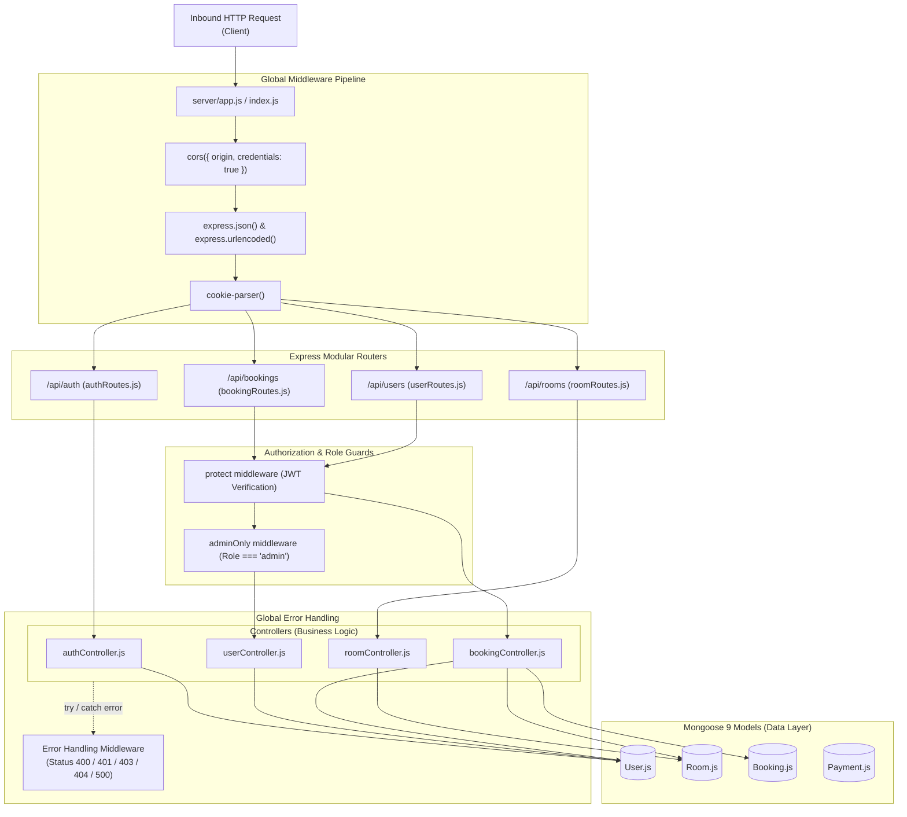

# Backend Architecture

## 1. Overview

The backend of HotelPro is constructed using **Node.js** and **Express 5**, organized according to the Model-View-Controller (MVC) architectural pattern (where the "View" is represented by JSON API responses returned to the React client).

---

## 2. Layered Architecture



---

## 3. Server Entry Point Configuration

The backend features two complementary entry points:
- **`server/app.js`**: Instantiates the Express application, configures global middleware (CORS, body parsing, cookies), mounts the four domain routers, and defines the global error handler.
- **`server/index.js`**: Loads environment variables with explicit directory path resolution (`path.join(__dirname, '.env')`), establishes the Mongoose connection to MongoDB Atlas, and binds the HTTP server to the designated `PORT`.

```javascript
// server/index.js snippet
require('dotenv').config({ path: path.join(__dirname, '.env') });
const mongoose = require('mongoose');
const app = require('./app');

const PORT = process.env.PORT || 5000;
const MONGO_URI = process.env.MONGO_URI;

mongoose.connect(MONGO_URI)
  .then(() => {
    console.log('Connected to MongoDB Atlas');
    app.listen(PORT, () => console.log(`Server running on port ${PORT}`));
  })
  .catch(err => console.error('MongoDB connection error:', err));
```

---

## 4. Middleware Pipeline

1. **`cors`**:
   - Explicitly configured with `origin: process.env.CLIENT_URL || 'http://localhost:5173'` and `credentials: true`. This allows session cookies to pass cross-origin without being blocked by browser SameSite policies.
2. **`express.json()`**:
   - Parses incoming JSON request payloads up to standard Express limits.
3. **`cookie-parser()`**:
   - Parses the `Cookie` header on incoming requests and populates `req.cookies`, allowing the authentication middleware to read `req.cookies.jwt`.
4. **`protect` (Authentication Guard)**:
   - Inspects `req.cookies.jwt` or `req.headers.authorization`.
   - Decodes the token using `process.env.JWT_SECRET`.
   - Loads the user from MongoDB Atlas (excluding password hash) and attaches it to `req.user`.
5. **`adminOnly` (Role Guard)**:
   - Inspects `req.user.role` or `req.user.isAdmin`.
   - If the user is not an administrator, immediately terminates the request with HTTP 403 Forbidden.
