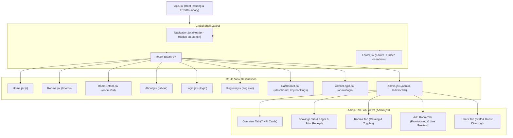

# Frontend Architecture

## 1. Overview

The HotelPro frontend is constructed with **React 19** and bundled with **Vite 8**. It adheres to a clean component hierarchy where global layout containers dynamically adjust depending on the user's navigational state (e.g., hiding public footers inside the dedicated admin management dashboard).

---

## 2. Component Hierarchy & Layout Structure



---

## 3. Dynamic Shell Conditioning

In `client/src/App.jsx`, the public navigation and footer are conditioned:
```jsx
const isAdminRoute = location.pathname.startsWith('/admin') && location.pathname !== '/admin/login';

return (
  <ErrorBoundary>
    <div className="d-flex flex-column min-vh-100">
      {!isAdminRoute && <Navigation />}
      <main className="flex-grow-1">
        <Routes> ... </Routes>
      </main>
      {!isAdminRoute && <Footer />}
    </div>
  </ErrorBoundary>
);
```
This guarantees that the Admin Portal occupies the complete viewport with its own dedicated sidebar, sticky topbar, and scrollable content area, free from duplicate public website headers.

---

## 4. State Management Model

HotelPro deliberately utilizes a lightweight, idiomatic React state management approach rather than heavy Redux or MobX stores:

1. **Global Auth State (`AuthContext.jsx`)**:
   - Manages: `user` object, `token` string, `loading` boolean.
   - Methods: `login(email, password)`, `register(userData)`, `logout()`, `updateProfile(data)`.
   - Persistence: Automatically re-syncs user profile on mount by inspecting `localStorage.getItem('user')` and issuing a background validation check to `GET /api/auth/profile`.
2. **Page-Level State (`useState`, `useEffect`)**:
   - Manages localized search queries, active filters, form submission states, modal visibility, and fetched data.
3. **URL State (`useParams`, `useNavigate`)**:
   - Manages active tab routing in Admin (`/admin/:tab`), allowing direct linking and bookmarking of sub-views (e.g. `/admin/add-room`, `/admin/bookings`).

---

## 5. Error Boundary Architecture (`ErrorBoundary.jsx`)

To prevent complete application blank-screen crashes if third-party image URLs fail or API payload mutations occur, the entire app is wrapped in a luxury-styled React Error Boundary:
- Catches unhandled JavaScript exceptions in child component trees.
- Displays a branded, elegant error card with a *"Reload Page"* action instead of an unstyled React error trace.
- Logs the exception to the developer console for debugging.
