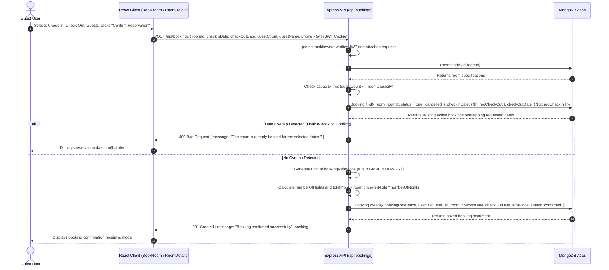
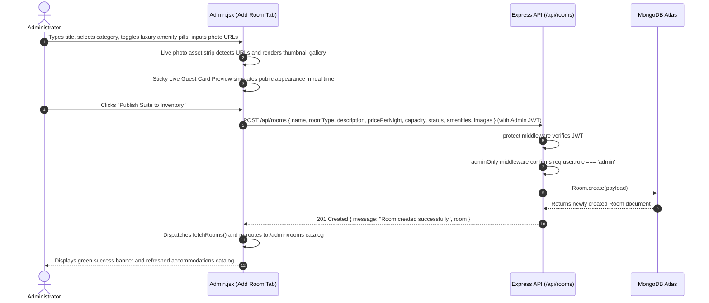

# Request-Response Flow

## 1. Overview

This document illustrates the end-to-end lifecycle of HTTP transactions between the React client, Express API, and MongoDB Atlas database.

---

## 2. Authentication Flow (Login & Session Verification)

```mermaid
sequenceDiagram
    autonumber
    actor Guest as Guest User
    participant Browser as React Frontend (Login.jsx)
    participant AuthContext as AuthContext.jsx
    participant API as Express API (/api/auth/login)
    participant DB as MongoDB Atlas (users collection)

    Guest->>Browser: Enters email and password, clicks "Sign In"
    Browser->>AuthContext: login(email, password)
    AuthContext->>API: POST /api/auth/login { email, password }
    API->>DB: User.findOne({ email })
    DB-->>API: Returns user document with passwordHash
    API->>API: bcrypt.compare(password, user.passwordHash)
    
    alt Password Invalid
        API-->>AuthContext: 401 Unauthorized { message: "Invalid email or password" }
        AuthContext-->>Browser: Sets error state
        Browser-->>Guest: Displays red alert banner
    else Password Valid
        API->>API: jwt.sign({ id: user._id, role: user.role }, JWT_SECRET, { expiresIn: '30d' })
        API-->>AuthContext: 200 OK + Set-Cookie: jwt=token; HttpOnly + JSON { _id, name, email, role, token }
        AuthContext->>AuthContext: setUser(data), localStorage.setItem('user', JSON.stringify(data))
        AuthContext-->>Browser: Redirects to /dashboard (or /admin if admin)
        Browser-->>Guest: Renders authenticated portal
    end
```

---

## 3. Room Reservation Flow with Double-Booking Conflict Prevention



---

## 4. Admin Suite Provisioning Flow (`/admin/add-room`)


