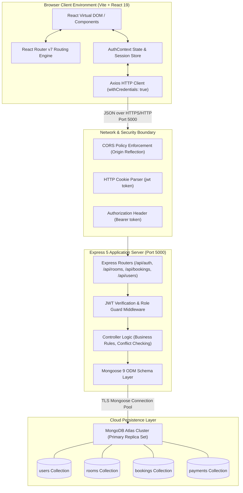

# System Architecture

## 1. High-Level System Architecture

HotelPro is architected as a decoupled, multi-tier Single Page Application (SPA) backed by a RESTful Express service and an isolated cloud document store (MongoDB Atlas).

---

## 2. Component Boundaries & Responsibilities

### Frontend Tier (`client/`)
- **Host Port**: `5173` (Vite dev server) or static production bundle.
- **Responsibilities**:
  - Render user interface, manage transient UI states (modals, search queries, filter tabs, active navigation).
  - Intercept unauthorized responses (`401 Unauthorized`) and redirect to `/login` or `/admin/login`.
  - Maintain client-side auth context synchronized with `localStorage` (cached user profile object) and HTTP cookies.
  - Deliver responsive views across Mobile (< 992px) with offcanvas sidebars, Tablet, and Desktop (> 1200px).

### Backend Tier (`server/`)
- **Host Port**: `5000` (configured via `PORT` environment variable).
- **Responsibilities**:
  - Enforce access control: guest vs. admin privileges.
  - Validate all inbound payloads against Mongoose model schemas.
  - Enforce transactional consistency and business logic (e.g., date overlap conflict detection).
  - Issue cryptographically signed JSON Web Tokens (JWT) with 30-day lifespans.
  - Normalize error responses into structured `{ message: string }` JSON payloads.

### Cloud Persistence Tier (MongoDB Atlas)
- **Engine**: MongoDB Atlas v6.0+
- **Responsibilities**:
  - Maintain ACID transactional safety on document modifications.
  - Store indexed fields for fast querying (`bookingReference`, `user`, `room`, `email`).
  - Isolate multi-tenant connections using authenticated cluster credentials.

---

## 3. Communication Protocols

| Channel | Protocol | Payload Format | Authentication Mechanism |
| :--- | :--- | :--- | :--- |
| **Client to Server** | HTTP / HTTPS (REST) | `application/json` | HTTP-only Cookie (`jwt`) or `Authorization: Bearer <token>` |
| **Server to MongoDB** | MongoDB Wire Protocol with TLS | BSON over TLS connection pool | SCRAM-SHA-256 via `MONGO_URI` |
| **Client to Image CDN** | HTTPS GET | Binary WebP / JPEG / PNG | Public Unsplash CDN URLs |

---

## 4. Scalability & Deployment Topology

In a production environment, HotelPro can be deployed as:
1. **Frontend**: Static site hosted on Vercel, Netlify, AWS CloudFront + S3, or Firebase Hosting.
2. **Backend**: Containerized Node.js service running on AWS ECS, Render, Railway, or Google Cloud Run.
3. **Database**: Managed MongoDB Atlas replica set with automated backups, monitoring, and horizontal read-replicas.
