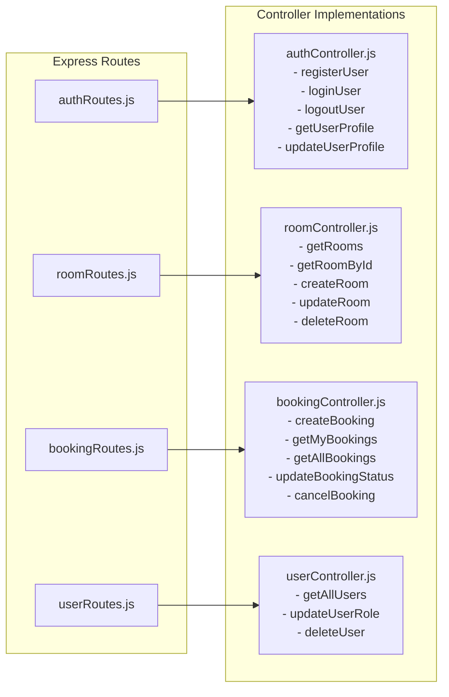

# Routes & Controllers

## 1. Overview

HotelPro isolates routing definitions (`server/routes/`) from execution controllers (`server/controllers/`), ensuring high maintainability and testability.

---

## 2. Route & Controller Mapping

---

## 3. Detailed Controller Method Breakdown

### `authController.js`
- `registerUser(req, res)`: Validates email uniqueness, creates salted password hash, saves User, generates JWT, sets cookie, and returns user payload.
- `loginUser(req, res)`: Finds user by email, verifies password via `bcrypt.compare`, signs 30-day JWT, sets cookie, and returns payload.
- `logoutUser(req, res)`: Overwrites `jwt` cookie with an expired value and maxAge 0.
- `getUserProfile(req, res)`: Returns authenticated user document from `req.user`.
- `updateUserProfile(req, res)`: Modifies name, email, or phone.

### `roomController.js`
- `getRooms(req, res)`: Parses query string filters (`roomType`, `status`), queries MongoDB Atlas, and returns array of suites.
- `getRoomById(req, res)`: Finds specific room by ObjectId or returns 404.
- `createRoom(req, res)`: Validates required specifications, validates non-negative price, and inserts new Room document.
- `updateRoom(req, res)`: Finds room by ID and applies patched properties.
- `deleteRoom(req, res)`: Removes room document from database.

### `bookingController.js`
- `createBooking(req, res)`: 
  1. Validates room existence.
  2. Confirms `guestCount <= room.capacity`.
  3. Executes date conflict query to ensure room is unreserved for the requested dates.
  4. Generates unique booking reference.
  5. Computes total price from nightly rate × duration.
  6. Creates Booking document.
- `getMyBookings(req, res)`: Queries `Booking.find({ user: req.user._id }).populate('room')`.
- `getAllBookings(req, res)`: Administrative query returning all bookings, populated with user and room details, sorted newest first.
- `updateBookingStatus(req, res)`: Updates `status` field (`confirmed`, `pending`, `cancelled`).
- `cancelBooking(req, res)`: Allows guests to cancel their own bookings or admins to cancel any booking.

### `userController.js`
- `getAllUsers(req, res)`: Returns all user documents excluding password hashes.
- `updateUserRole(req, res)`: Updates `role` and synchronizes `isAdmin` boolean.
- `deleteUser(req, res)`: Deletes user record by ID.
