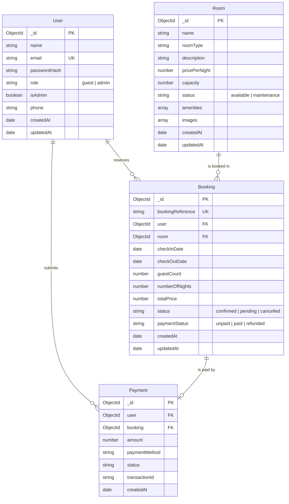

# Data Models

## 1. Overview

HotelPro manages four primary collections inside MongoDB Atlas via Mongoose 9 models located in `server/models/`:
- `User`: Guest and staff accounts.
- `Room`: Accommodations catalog and unit inventory.
- `Booking`: Reservation contracts and operational statuses.
- `Payment`: Financial transaction records.

---

## 2. Entity-Relationship Diagram



---

## 3. Pre-Save Lifecycle Hooks (`User.js`)

In `server/models/User.js`, a pre-save hook maintains strict synchronization between `role` and `isAdmin`:

```javascript
userSchema.pre('save', function (next) {
  if (this.isModified('role')) {
    this.isAdmin = this.role === 'admin';
  } else if (this.isModified('isAdmin')) {
    this.role = this.isAdmin ? 'admin' : 'guest';
  }
  if (typeof next === 'function') {
    next();
  }
});
```
This guarantees that promoting a user via `user.role = 'admin'` automatically updates `user.isAdmin = true`, eliminating role desynchronization bugs across the system.
