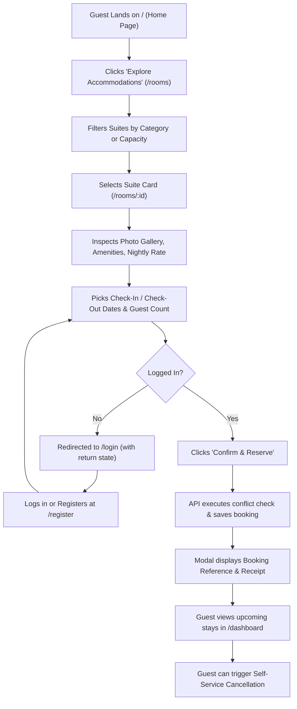

# Guest Workflows

## 1. Overview

The guest workflow covers discovery of hotel suites, reviewing amenities, selecting reservation dates, instant booking confirmation, and self-service booking cancellation.

---

## 2. Step-by-Step Guest Journey

---

## 3. Key Pages & Features

1. **Suite Discovery (`/rooms`)**:
   - Interactive category pills: All, Deluxe Suite, Executive Suite, Ocean Villa, etc.
   - Price per night badge in warm gold.
   - Max capacity indicator with guest icon.
2. **Suite Details & Reservation Engine (`/rooms/:id`)**:
   - Interactive photo gallery with thumbnails.
   - Verified signature amenities grid (Wi-Fi, Private Balcony, King Bed, Soaking Tub).
   - Date picker checking that Check-Out is strictly after Check-In.
   - Live total price calculator (Nightly Rate $\times$ Nights).
3. **Guest Dashboard (`/dashboard` & `/my-bookings`)**:
   - Tabular and card ledger of all past and upcoming stays.
   - Status indicators: `Confirmed` (green), `Pending` (amber), `Cancelled` (gray).
   - Self-service "Cancel Booking" button with immediate database update.
