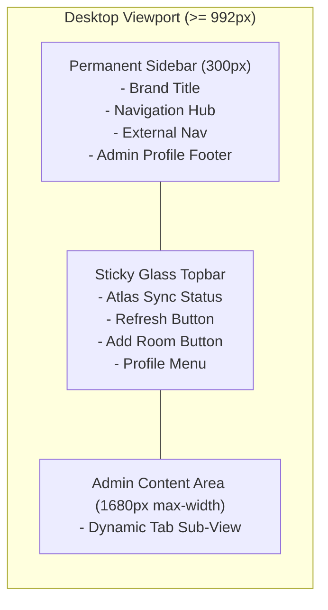

# Frontend Components & Layouts

## 1. Overview

HotelPro provides a modular component architecture partitioned into shared layout primitives, feedback guards, and specialized page components.

---

## 2. Reusable Component Inventory

### `Navigation.jsx` (Global Header)
- **Path**: `client/src/components/Navigation.jsx`
- **Features**:
  - Sticky glassmorphic header (`backdrop-filter: blur(10px)`).
  - Gold brand emblem and typography.
  - Active navigation highlights using `useLocation`.
  - Conditional authentication state:
    - *Unauthenticated*: "Sign In" and "Register" buttons + subtle "Staff Portal" link.
    - *Authenticated Guest*: User avatar circle, first name, and dropdown containing "My Reservations", "Profile", and "Sign Out".
    - *Authenticated Admin*: Displays a distinct "Admin Dashboard" button with a golden shield icon.
  - Responsive hamburger drawer on mobile/tablet screens.

### `Footer.jsx` (Global Footer)
- **Path**: `client/src/components/Footer.jsx`
- **Features**:
  - Deep navy background (`#0A1424`) with subtle gold divider borders.
  - Multi-column layout: Resort narrative, Quick Navigation, Suite Categories, and Contact Details.
  - Direct link to the Staff & Management Portal (`/admin/login`).
  - Standard copyright notice and hospitality certifications.

### `ErrorBoundary.jsx` (Luxury Error Fallback)
- **Path**: `client/src/components/ErrorBoundary.jsx`
- **Features**:
  - Class component implementing `componentDidCatch` and `getDerivedStateFromError`.
  - Replaces uncaught runtime crashes with a high-end luxury card:
    - Warning icon with gold glow.
    - User-friendly error message.
    - "Reload Portal" button that cleans stale state and refreshes the page safely.

### `ProtectedRoute.jsx` (Access Guard)
- **Path**: `client/src/components/ProtectedRoute.jsx`
- **Features**:
  - Accepts `children` and an optional `adminOnly` boolean prop.
  - Manages asynchronous auth loading without content flicker.
  - Redirects unauthorized visitors while preserving their intended destination in history state.

---

## 3. Administrative Layout System (`Admin.jsx`)

The administrative dashboard implements an enterprise dual-navigation layout:

### Mobile Offcanvas Drawer
On mobile devices (< 992px), `.admin-sidebar-desktop` is hidden via CSS (`display: none;`). A clean hamburger button appears in `.admin-topbar`, triggering a responsive React-Bootstrap `Offcanvas` drawer containing the identical sidebar navigation links and active state highlighting.
