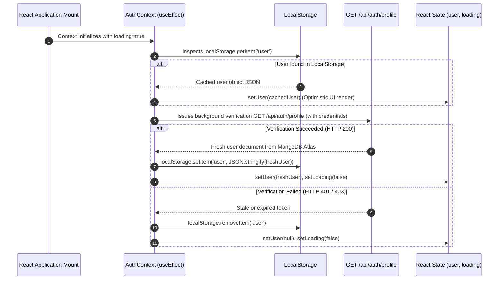

# State Management & Authentication

## 1. Overview

HotelPro manages global application state using a centralized **React Context** (`AuthContext`), eliminating third-party boilerplate while providing reactive authentication, session recovery, and role-based access control.

---

## 2. `AuthContext` Architecture (`client/src/context/AuthContext.jsx`)

### State Shape
```typescript
interface AuthContextState {
  user: {
    _id: string;
    name: string;
    email: string;
    role: 'guest' | 'admin';
    isAdmin: boolean;
    phone?: string;
  } | null;
  token: string | null;
  loading: boolean;
  login: (email: string, password: string) => Promise<void>;
  register: (userData: object) => Promise<void>;
  logout: () => Promise<void>;
  updateProfile: (userData: object) => Promise<void>;
}
```

---

## 3. Session Recovery & Persistence Lifecycle

When a user visits the application or refreshes their browser tab, the following lifecycle occurs:



---

## 4. Dual Token & Cookie Security

HotelPro employs a defense-in-depth session model:
1. **HTTP-only Cookie**: The server automatically sets `jwt` in an HTTP-only cookie during login. JavaScript in the browser cannot inspect or alter this cookie, defending against Cross-Site Scripting (XSS) credential theft.
2. **Authorization Header**: The client also retains the token returned in the login JSON response and configures Axios headers (`Bearer <token>`). This ensures compatibility across environments where third-party cookie restrictions are enforced.
