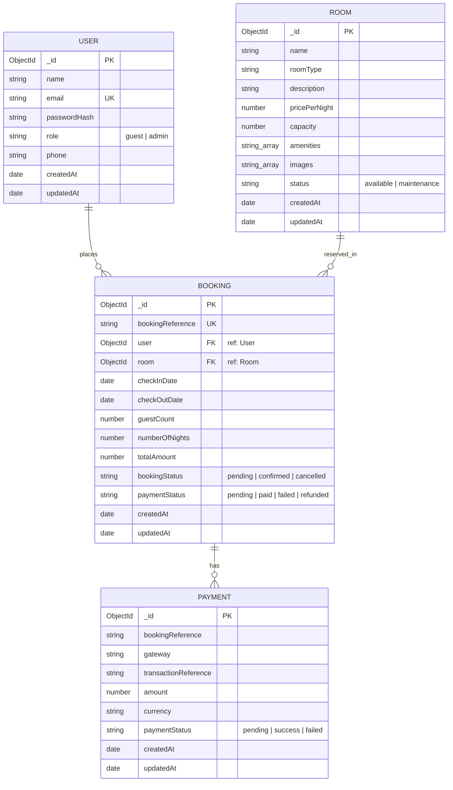

# HotelPro — Entity Relationship (ER) Diagram & Database Architecture

This document provides a detailed overview of the database design, entity schemas, relationships, and security considerations for the **HotelPro** hotel booking and management platform.

---

## 1. Overview

HotelPro uses MongoDB as its primary datastore with Mongoose as the Object Data Modeling (ODM) layer. The database schema is designed to ensure financial data integrity, efficient queries for room availability, role-based access control, and complete separation of authentication credentials from sensitive payment operations.

---

## 2. Mermaid ER Diagram

---

## 3. Entity Schemas & Attributes

The schemas documented below directly map to the Mongoose models implemented in `server/src/models/`.

### 3.1 User Entity (`User.js`)
Stores account information for guests and platform administrators.

| Attribute | Data Type | Constraints / Details |
| :--- | :--- | :--- |
| `_id` | ObjectId | Primary Key (Auto-generated by MongoDB) |
| `name` | String | Required |
| `email` | String | Required, Unique, Lowercase |
| `passwordHash` | String | Required (Salted bcrypt hash; **never** plaintext) |
| `role` | String | Enum: `['guest', 'admin']`, Default: `'guest'` |
| `phone` | String | Optional |
| `createdAt` | Date | Timestamp (Auto-generated) |
| `updatedAt` | Date | Timestamp (Auto-generated) |

### 3.2 Room Entity (`Room.js`)
Stores room inventory details, pricing, capacity, and current availability status.

| Attribute | Data Type | Constraints / Details |
| :--- | :--- | :--- |
| `_id` | ObjectId | Primary Key (Auto-generated by MongoDB) |
| `name` | String | Required |
| `roomType` | String | Required (e.g. Deluxe, Suite, Single) |
| `description` | String | Required |
| `pricePerNight` | Number | Required |
| `capacity` | Number | Required (Maximum guests allowed) |
| `amenities` | Array of Strings | Optional list of room features |
| `images` | Array of Strings | Array of image URLs |
| `status` | String | Enum: `['available', 'maintenance']`, Default: `'available'` |
| `createdAt` | Date | Timestamp (Auto-generated) |
| `updatedAt` | Date | Timestamp (Auto-generated) |

### 3.3 Booking Entity (`Booking.js`)
Tracks guest reservations, dates, pricing snapshots, and booking lifecycle statuses.

| Attribute | Data Type | Constraints / Details |
| :--- | :--- | :--- |
| `_id` | ObjectId | Primary Key (Auto-generated by MongoDB) |
| `bookingReference` | String | Required, Unique (Formatted as `BKG-XXXXXXXX`) |
| `user` | ObjectId | Foreign Key referencing `User` model (`ref: 'User'`) |
| `room` | ObjectId | Foreign Key referencing `Room` model (`ref: 'Room'`) |
| `checkInDate` | Date | Required |
| `checkOutDate` | Date | Required |
| `guestCount` | Number | Required |
| `numberOfNights` | Number | Required |
| `totalAmount` | Number | Required |
| `bookingStatus` | String | Enum: `['pending', 'confirmed', 'cancelled']`, Default: `'pending'` |
| `paymentStatus` | String | Enum: `['pending', 'paid', 'failed', 'refunded']`, Default: `'pending'` |
| `createdAt` | Date | Timestamp (Auto-generated) |
| `updatedAt` | Date | Timestamp (Auto-generated) |

### 3.4 Payment Entity (`Payment.js`)
Tracks gateway transaction metadata linked to a booking reference.

| Attribute | Data Type | Constraints / Details |
| :--- | :--- | :--- |
| `_id` | ObjectId | Primary Key (Auto-generated by MongoDB) |
| `bookingReference` | String | Required (Matches `Booking.bookingReference`) |
| `gateway` | String | Default: `'razorpay-test'` |
| `transactionReference` | String | Optional (Payment gateway transaction ID / signature) |
| `amount` | Number | Required |
| `currency` | String | Default: `'USD'` |
| `paymentStatus` | String | Enum: `['pending', 'success', 'failed']`, Default: `'pending'` |
| `createdAt` | Date | Timestamp (Auto-generated) |
| `updatedAt` | Date | Timestamp (Auto-generated) |

---

## 4. Entity Relationships

1. **User to Booking (One-to-Many / 1:N)**:
   - A single `User` can create multiple `Booking` records over time.
   - Each `Booking` belongs to exactly one `User`, referenced via `Booking.user`.

2. **Room to Booking (One-to-Many / 1:N)**:
   - A single `Room` can be reserved across multiple non-overlapping date ranges.
   - Each `Booking` reserves exactly one `Room`, referenced via `Booking.room`.

3. **Booking to Payment (One-to-Many / 1:N)**:
   - Each `Booking` generates a unique `bookingReference` which links to `Payment` transaction logs.
   - A `Booking` can have multiple payment attempts (e.g. pending, failed, retried success).

---

## 5. Security & Design Considerations

- **Password Security**: Plaintext passwords and confirmation passwords are **never** stored in the database. Only one-way salted bcrypt hashes (`passwordHash`) are stored.
- **PCI-DSS Compliance**: Raw credit card numbers, CVV codes, and expiry dates are **never** stored or processed by the database. Payments use tokenized transaction references returned by third-party gateways (e.g., Razorpay test mode).
- **Concurrency & Double-Booking Prevention**: Server-side queries evaluate overlapping date windows (`checkInDate < outDate AND checkOutDate > inDate`) for active (`$ne: 'cancelled'`) bookings before inserting new reservations.
- **Financial Audit Trail**: Total amounts and night calculations are snapshot at booking creation time to preserve historical financial accuracy even if room prices change in the future.
