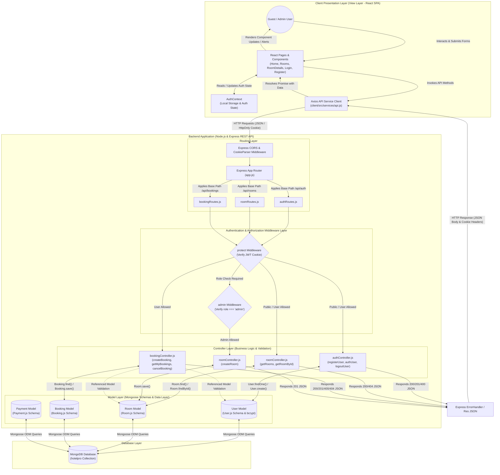

# HotelPro MVC Architecture Documentation

This document describes the **Model-View-Controller (MVC)** architectural pattern implemented in the **HotelPro** hotel booking and management system.

---

## 1. Introduction & Architecture Overview

HotelPro is built using a modern decoupled **MERN stack** (MongoDB, Express.js, React.js, Node.js). It adheres to a clean separation of concerns across data persistence, business logic, routing, and user interface presentation.

- **Model Layer (Data & Persistence)**: Mongoose schemas defining MongoDB collections (`User`, `Room`, `Booking`, `Payment`), data validation rules, instance methods, and cross-document relationships.
- **Controller Layer (Business Logic & Request Processing)**: Express controller functions (`authController.js`, `roomController.js`, `bookingController.js`) that handle HTTP requests, validate input data, enforce domain rules (such as double-booking checks and price calculations), invoke Mongoose ODM queries, and construct JSON responses.
- **Routing & Middleware Layer (Dispatch & Security)**: Express route definitions (`authRoutes.js`, `roomRoutes.js`, `bookingRoutes.js`) mapping HTTP endpoints to controllers, integrated with `protect` (JWT validation) and `admin` (role authorization) middleware.
- **View / Presentation Layer (Single Page Application)**: React 18 components, Bootstrap 5 UI, `AuthContext` state, and an Axios HTTP client (`api.js`). 

> **Architecture Clarification**: HotelPro uses a decoupled RESTful API backend paired with a React Single-Page Application (SPA). Express does not serve server-side HTML views (e.g., EJS or Pug templates). Instead, the React frontend functions as the View layer, rendering dynamic UI based on JSON data exchanged with the Express backend, which implements internal MVC separation.

---

## 2. Model Layer (Data Persistence)

The Model layer is located in `server/src/models/`. It encapsulates database schemas, validation rules, default field values, and document methods using Mongoose ODM.

### 2.1 User Model (`User.js`)
- **Schema Fields**:
  - `name`: `{ type: String, required: true }`
  - `email`: `{ type: String, required: true, unique: true }`
  - `passwordHash`: `{ type: String, required: true }` (Stores salted `bcryptjs` hash)
  - `role`: `{ type: String, enum: ['guest', 'admin'], default: 'guest' }`
  - `phone`: `{ type: String }`
  - `timestamps`: Automatically manages `createdAt` and `updatedAt`.
- **Document Instance Methods**:
  - `matchPassword(enteredPassword)`: Compares candidate plaintext password against `passwordHash` using `bcrypt.compare()`.

### 2.2 Room Model (`Room.js`)
- **Schema Fields**:
  - `name`: `{ type: String, required: true }`
  - `roomType`: `{ type: String, required: true }` (e.g., Single, Double, Suite, Deluxe)
  - `description`: `{ type: String, required: true }`
  - `pricePerNight`: `{ type: Number, required: true }`
  - `capacity`: `{ type: Number, required: true }`
  - `amenities`: `[String]` (List of features like WiFi, TV, AC)
  - `images`: `[String]` (URLs to room images)
  - `status`: `{ type: String, enum: ['available', 'maintenance'], default: 'available' }`
  - `timestamps`: `true`.

### 2.3 Booking Model (`Booking.js`)
- **Schema Fields**:
  - `bookingReference`: `{ type: String, required: true, unique: true }` (Formated as `BKG-XXXXXX`)
  - `user`: `{ type: mongoose.Schema.Types.ObjectId, required: true, ref: 'User' }` (Foreign key reference to `User`)
  - `room`: `{ type: mongoose.Schema.Types.ObjectId, required: true, ref: 'Room' }` (Foreign key reference to `Room`)
  - `checkInDate`: `{ type: Date, required: true }`
  - `checkOutDate`: `{ type: Date, required: true }`
  - `guestCount`: `{ type: Number, required: true }`
  - `numberOfNights`: `{ type: Number, required: true }`
  - `totalAmount`: `{ type: Number, required: true }`
  - `bookingStatus`: `{ type: String, enum: ['pending', 'confirmed', 'cancelled'], default: 'pending' }`
  - `paymentStatus`: `{ type: String, enum: ['pending', 'paid', 'failed', 'refunded'], default: 'pending' }`
  - `timestamps`: `true`.

### 2.4 Payment Model (`Payment.js`)
- **Schema Fields**:
  - `bookingReference`: `{ type: String, required: true }`
  - `gateway`: `{ type: String, default: 'razorpay-test' }`
  - `transactionReference`: `{ type: String }`
  - `amount`: `{ type: Number, required: true }`
  - `currency`: `{ type: String, default: 'USD' }`
  - `paymentStatus`: `{ type: String, enum: ['pending', 'success', 'failed'], default: 'pending' }`
  - `timestamps`: `true`.

---

## 3. Controller Layer (Business Logic)

Located in `server/src/controllers/`, the Controller layer contains asynchronous request handlers that orchestrate input parsing, domain validation, database operations via Mongoose models, and HTTP response rendering.

```
Incoming Request ──> Controller Function ──> Mongoose ODM Query ──> Return JSON Response
```

### 3.1 Auth Controller (`authController.js`)
- **`registerUser(req, res, next)`**:
  - Extracts `name`, `email`, `password`, `phone` from `req.body`.
  - Checks duplicate email via `User.findOne({ email })`.
  - Hashes password using `bcrypt.genSalt(10)` and `bcrypt.hash()`.
  - Creates user via `User.create()`. Public registration locks role to `guest`.
  - Issues HttpOnly JWT cookie (`generateToken`) and returns `201 Created`.
- **`authUser(req, res, next)`**:
  - Validates credentials via `User.findOne({ email })` and `user.matchPassword(password)`.
  - On success, issues HttpOnly JWT cookie and returns user JSON (`200 OK`).
  - On failure, sets status `401` and throws error `'Invalid email or password'`.
- **`logoutUser(req, res)`**:
  - Clears `jwt` cookie by expiring it immediately (`expires: new Date(0)`).

### 3.2 Room Controller (`roomController.js`)
- **`getRooms(req, res, next)`**: Fetches all rooms via `Room.find({})` and returns array JSON.
- **`getRoomById(req, res, next)`**: Fetches room by ID via `Room.findById(id)`. Returns `404` if not found.
- **`createRoom(req, res, next)`**: Admin-only controller that creates a new room via `Room.save()`.

### 3.3 Booking Controller (`bookingController.js`)
- **`createBooking(req, res, next)`**:
  - Converts date strings and verifies `checkOutDate > checkInDate`.
  - Validates room existence and capacity (`guestCount <= room.capacity`).
  - **Double-Booking Prevention**: Runs MongoDB overlap query checking active non-cancelled bookings.
  - Computes `numberOfNights` and `totalAmount = nights * room.pricePerNight`.
  - Generates random reference `BKG-XXXXXX` and creates booking record (`201 Created`).
- **`getMyBookings(req, res, next)`**: Queries `Booking.find({ user: req.user._id })` and populates room details (`populate('room')`).
- **`cancelBooking(req, res, next)`**:
  - Verifies user ownership (`booking.user === req.user._id`) or admin status.
  - Verifies check-in date is in the future (`checkInDate >= today`).
  - Updates `bookingStatus = 'cancelled'` and returns updated document.

---

## 4. Routing Layer & Middleware

Located in `server/src/routes/` and `server/src/middleware/`, this layer exposes endpoints, maps HTTP verbs, and protects private routes.

### 4.1 Route Declarations

```
Express Server (app.js)
  │
  ├──> /api/auth     ──> authRoutes.js    (POST /register, POST /login, POST /logout)
  ├──> /api/rooms    ──> roomRoutes.js    (GET /, POST / [admin], GET /:id)
  └──> /api/bookings ──> bookingRoutes.js (POST / [protect], GET /my [protect], PUT /:id/cancel [protect])
```

### 4.2 Security Middleware (`auth.js`)
- **`protect` Middleware**:
  - Reads HttpOnly cookie `req.cookies.jwt`.
  - Decodes token using `jwt.verify(token, process.env.JWT_SECRET)`.
  - Attaches user document (excluding `passwordHash`) to `req.user`.
  - Passes control to controller via `next()`. If missing/invalid, throws `401 Unauthorized`.
- **`admin` Middleware**:
  - Verifies `req.user && req.user.role === 'admin'`. Throws `401` if user lacks admin privileges.

---

## 5. View / Presentation Layer (React SPA)

The presentation layer is implemented as a React SPA in `client/src/`.

### 5.1 Component Structure & State
- **`App.jsx`**: Top-level routing setup (`BrowserRouter`, `Routes`, `Route`).
- **`AuthContext.jsx`**: Global authentication provider managing `user` state, initializing from `localStorage` (`userInfo`), and exposing `login`, `register`, and `logout` helpers.
- **`services/api.js`**: Centralized Axios instance configured with `baseURL: '/api'` and `withCredentials: true` to automatically send and receive HttpOnly cookies.

### 5.2 Pages & Interactions
- **`Home.jsx`**: Hero banner, promotional highlights, navigation links.
- **`Rooms.jsx`**: Room catalog rendering, search filter, room type dropdown, capacity and price range filters.
- **`RoomDetails.jsx`**: Detailed room view, date selection form, live price calculator (`nights * pricePerNight`), and submission handler calling `api.post('/bookings')`.
- **`Login.jsx` / `Register.jsx`**: Input forms with validation states and submit handlers invoking `AuthContext` authentication methods.

---

## 6. End-to-End Request Lifecycles

### 6.1 User Login Lifecycle (`POST /api/auth/login`)
1. **User Action**: User submits email/password on `Login.jsx`.
2. **View Invocation**: `handleSubmit` calls `login(email, password)` from `AuthContext`.
3. **HTTP Client**: `api.js` fires `POST http://localhost:5000/api/auth/login` with JSON body.
4. **Router**: `app.js` routes request to `authRoutes.js`, invoking `authUser`.
5. **Controller & Model**: `authController.js` fetches user via `User.findOne({ email })` and executes `user.matchPassword()`.
6. **Token & Response**: Controller calls `generateToken(res, user._id)` setting `Set-Cookie: jwt=...; HttpOnly` header and returns `{ _id, name, email, role }`.
7. **UI Update**: `AuthContext` stores user data in `localStorage` and updates state, triggering a redirect to `/`.

### 6.2 Room Listing Lifecycle (`GET /api/rooms`)
1. **User Action**: User navigates to `/rooms`.
2. **View Invocation**: `Rooms.jsx` runs `useEffect` hook.
3. **HTTP Client**: `api.get('/rooms')` sends HTTP GET request.
4. **Router & Controller**: `app.js` -> `roomRoutes.js` -> `getRooms` controller.
5. **Model & Database**: `Room.find({})` queries MongoDB `rooms` collection.
6. **Response & UI Render**: Array of room objects returned; `Rooms.jsx` updates state and renders room cards.

### 6.3 Booking Creation Lifecycle (`POST /api/bookings`)
1. **User Action**: User selects dates/guests on `RoomDetails.jsx` and clicks "Book Now".
2. **HTTP Client**: `api.post('/bookings', { room, checkInDate, checkOutDate, guestCount })`.
3. **Middleware**: `protect` reads `req.cookies.jwt`, validates JWT, attaches `req.user`, and calls `next()`.
4. **Controller Logic**: `createBooking` validates dates (`checkOut > checkIn`), checks `guestCount <= capacity`, and executes double-booking overlap query.
5. **Model & Database**: `new Booking({...}).save()` persists booking in MongoDB `bookings` collection.
6. **Response**: Controller returns `201 Created` with generated reference `BKG-XXXXXX`. `RoomDetails.jsx` renders success alert.

### 6.4 Booking Cancellation Lifecycle (`PUT /api/bookings/:id/cancel`)
1. **User Action**: Guest or Admin clicks "Cancel Booking".
2. **Middleware**: `protect` middleware verifies user JWT.
3. **Controller Validation**: `cancelBooking` verifies ownership (`booking.user === req.user._id` or `admin`), checks `checkInDate >= today`, and ensures booking is not already cancelled.
4. **Database Update**: `booking.bookingStatus = 'cancelled'; booking.save()`.
5. **Response**: Updated booking returned, UI updates status badge.

---

## 7. Architecture Diagram

The full Mermaid diagram source is located in [`docs/project-architecture/mvc-pattern.mmd`](mvc-pattern.mmd).



---

## 8. Architectural Advantages

1. **Separation of Concerns**: Database logic is isolated in Models, request orchestration in Controllers, route security in Middleware, and UI rendering in React components.
2. **Maintainability & Modular Structure**: Changes to database schemas do not directly break UI rendering as long as controller JSON responses maintain their contract.
3. **Security Isolation**: Password hashing (`bcryptjs`) and JWT management are contained within auth controllers and middleware.
4. **Reusability & Scalability**: Centralized Axios configuration (`api.js`) handles credentials globally. Express controllers can easily serve mobile apps or third-party clients.
5. **Team Collaboration**: Frontend developers work independently on React UI components while backend developers build and test Express controllers and Mongoose models.

---

## 9. Architectural Limitations & Current Gaps

- **Dashboard UI Views**: Frontend routes `/dashboard` and `/admin` currently render placeholder components.
- **Payment Layer**: Mongoose `Payment` model is defined, but payment gateway routes and controllers are pending live Razorpay integration.
- **User Management APIs**: Deleting users or modifying roles via Admin API endpoints is not yet implemented.
