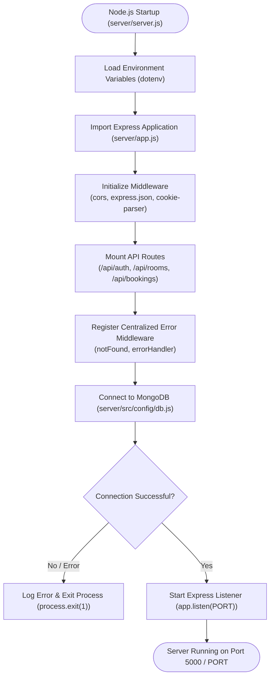

# HotelPro Server Setup Documentation

This document describes the server configuration, directory structure, initialization sequence, environment settings, and dependency management for the **HotelPro** backend application.

---

## 1. Overview & Directory Structure

The HotelPro backend is powered by **Node.js**, **Express.js**, and **MongoDB** (via Mongoose). It follows a clean modular architecture located under `server/`:

```
server/
├── .env.example              # Sample environment configuration template
├── app.js                    # Express app configuration & middleware pipeline
├── package.json              # Backend dependencies & npm scripts (start, dev)
├── server.js                 # Primary server entry point & HTTP listener setup
└── src/
    ├── config/
    │   └── db.js             # Mongoose MongoDB connection configuration
    ├── controllers/
    │   ├── authController.js # Auth request handlers (register, login, logout)
    │   ├── bookingController.js # Booking request handlers (create, list, cancel)
    │   └── roomController.js # Room request handlers (list, get by ID, create)
    ├── middleware/
    │   ├── auth.js           # JWT verification & admin role authorization
    │   └── errorMiddleware.js# Centralized 404 & 500 error handlers
    ├── models/
    │   ├── Booking.js        # Mongoose schema for Bookings
    │   ├── Payment.js        # Mongoose schema for Payments
    │   ├── Room.js           # Mongoose schema for Rooms
    │   └── User.js           # Mongoose schema for Users (bcrypt hashing)
    └── routes/
        ├── authRoutes.js     # Auth API routes (/api/auth)
        ├── bookingRoutes.js  # Booking API routes (/api/bookings)
        └── roomRoutes.js     # Room API routes (/api/rooms)
```

---

## 2. Package & Dependency Verification (`server/package.json`)

The server configuration in `server/package.json` defines required production dependencies and execution scripts.

### 2.1 Dependencies Breakdown
- **`express` (`^5.3.0`)**: Core web application framework for routing and middleware.
- **`mongoose` (`^9.11.1`)**: Object Data Modeling (ODM) library for MongoDB.
- **`dotenv` (`^18.0.7`)**: Environment variable management from `.env` files.
- **`jsonwebtoken` (`^9.0.3`)**: Issues and verifies JSON Web Tokens for authentication.
- **`bcryptjs` (`^3.0.3`)**: Password hashing and salt generation.
- **`cookie-parser` (`^1.4.7`)**: Parses HttpOnly cookies for JWT authentication.
- **`cors` (`^2.8.6`)**: Configures Cross-Origin Resource Sharing with credentials support (`origin: 'http://localhost:5173'`).
- **`nodemon` (`^3.1.14` - devDependency)**: Hot-reloading development server runner.

### 2.2 Execution Scripts
- **`npm start`**: Runs `node server.js` for production runtime.
- **`npm run dev`**: Runs `nodemon server.js` for development with automatic restarts on file changes.

---

## 3. Server Entry Point & Initialization Sequence

The entry point for the backend is `server/server.js`, working in conjunction with `server/app.js` and `server/src/config/db.js`.

### 3.1 Startup Workflow (`server/server.js`)
1. **Environment Configuration**: `require('dotenv').config()` loads environment variables (`PORT`, `MONGO_URI`, `JWT_SECRET`, `CLIENT_URL`) at startup.
2. **App Initialization**: Imports configured Express application from `./app`.
3. **Database Connection**: Calls `connectDB()` from `./src/config/db`.
4. **Listener Execution**: Upon successful MongoDB connection, starts Express HTTP listener on `process.env.PORT` (defaults to `5000`).
5. **Startup Error Handling**: If MongoDB connection fails, the process catches the error, logs it to `console.error`, and terminates safely via `process.exit(1)`.

### 3.2 Middleware Pipeline (`server/app.js`)
1. **CORS Middleware**: `cors({ origin: process.env.CLIENT_URL || 'http://localhost:5173', credentials: true })`
2. **JSON Parser**: `express.json()` parses incoming JSON bodies.
3. **Cookie Parser**: `cookieParser()` parses HttpOnly cookies for JWT authentication.
4. **API Route Mounting**:
   - `/api/auth` -> `authRoutes.js`
   - `/api/rooms` -> `roomRoutes.js`
   - `/api/bookings` -> `bookingRoutes.js`
5. **Centralized Error Handling**:
   - `notFound`: Catches unhandled routes and forwards `404 Not Found` errors.
   - `errorHandler`: Returns structured JSON error responses with status codes and optional stack traces in development.

---

## 4. Startup Flow Diagram

The complete startup sequence is documented in [`docs/project-architecture/server-setup.mmd`](server-setup.mmd).



---

## 5. Environment Configuration

Server environment settings are specified in `server/.env`:

```env
PORT=5000
MONGO_URI=mongodb://localhost:27017/hotelpro
JWT_SECRET=your_jwt_secret_key_here
NODE_ENV=development
CLIENT_URL=http://localhost:5173
```
