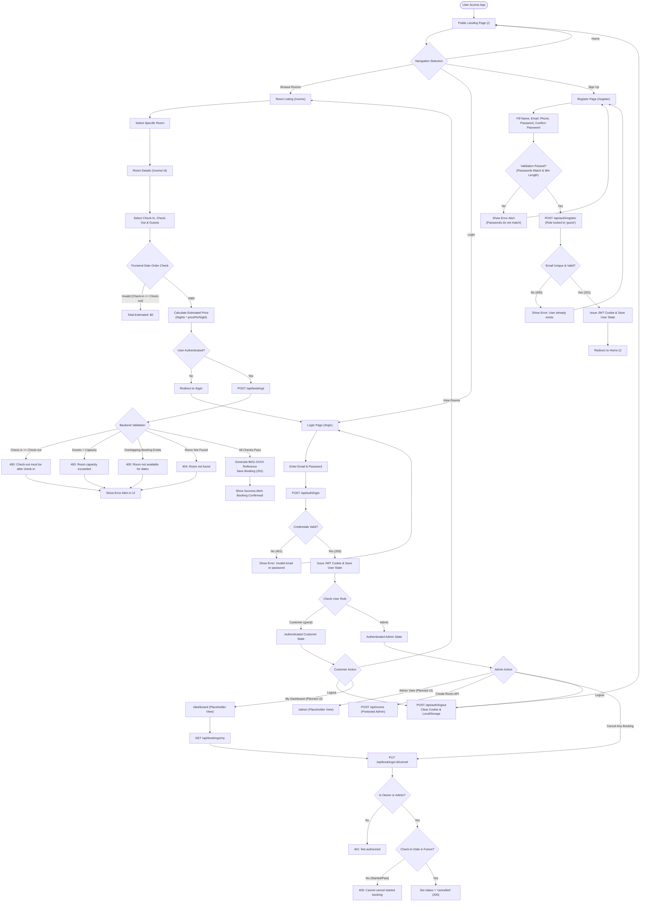

# HotelPro User Flow Documentation

This document describes the customer and administrator journeys, authentication workflows, booking processes, and system routing within the **HotelPro** hotel booking and management application.

---

## 1. Overview & Architectural Context

HotelPro is built on the **MERN** stack (MongoDB, Express.js, React.js, Node.js).
- **Frontend Routing**: React Router DOM (`/`, `/login`, `/register`, `/rooms`, `/rooms/:id`, `/dashboard`, `/admin`)
- **Backend API Base**: `/api/auth`, `/api/rooms`, `/api/bookings`
- **State & Authentication**: `AuthContext` managing local user state (`userInfo` in `localStorage`) paired with server-side **HttpOnly JWT cookies** (`jwt`).

### Implementation Status Matrix
| Workflow / Feature | Implementation Status | Technical Details |
| :--- | :--- | :--- |
| Visitor Landing & Navigation | **Implemented** | Responsive Navbar, Hero Banner, Featured Highlights |
| Room Browsing & Filtering | **Implemented** | `/rooms` page with search, type filter, capacity & price filters |
| Room Details & Booking Form | **Implemented** | `/rooms/:id` with dynamic night & price estimation |
| User Registration | **Implemented** | `POST /api/auth/register`, client & server validation, role locked to `guest` |
| User Login & Auth Persist | **Implemented** | `POST /api/auth/login`, HttpOnly JWT cookie set, stored in `localStorage` |
| User Logout | **Implemented** | `POST /api/auth/logout`, clears HttpOnly cookie & `localStorage` |
| Backend Booking Creation | **Implemented** | `POST /api/bookings` with capacity & overlap prevention |
| Backend Booking Cancel | **Implemented** | `PUT /api/bookings/:id/cancel` with ownership & date checks |
| Admin Room Creation API | **Implemented** | `POST /api/rooms` guarded by `protect` and `admin` middleware |
| Customer Dashboard UI | **Planned / Placeholder**| Route `/dashboard` exists with placeholder component |
| Admin Dashboard UI | **Planned / Placeholder**| Route `/admin` exists with placeholder component |
| User Management / Deletion API | **Not Implemented** | Planned for future release |

---

## 2. Visitor Journey (Unauthenticated)

The public landing page (`/`) serves as the main entry point for unauthenticated visitors.

```
Landing Page (/) ──┬──> Navbar: Home, Rooms, Login, Sign Up
                  ├──> Hero Banner with Call to Action ("Explore Rooms")
                  ├──> Features / Highlights Section
                  └──> Footer (Copyright & Branding)
```

### Main Sections & Entry Points
1. **Header / Navigation Bar**:
   - Brand logo linking to Home (`/`).
   - Navigation links: **Home** (`/`), **Rooms** (`/rooms`).
   - Authentication actions: **Login** (`/login`), **Sign Up** (`/register`).
2. **Hero Banner**:
   - Displays hotel motto and primary call-to-action button linking directly to the room catalog (`/rooms`).
3. **Room Highlights & Browsing**:
   - Visitors can navigate to `/rooms` to view all available room listings, search by name, filter by room type (Single, Double, Suite, Deluxe), filter by guest capacity, and inspect pricing per night.
4. **About / Features Section**:
   - Highlight cards detailing luxury amenities, 24/7 service, and instant confirmation.

---

## 3. Registration Flow

The registration journey allows new customers to create an account.

```
Fill Form (Name, Email, Phone, Password, Confirm Password)
        │
        ▼
Client Validation (Passwords Match? Password length >= 6?)
        │
     Yes│ No ──> Display Error Alert: "Passwords do not match"
        ▼
POST /api/auth/register
        │
        ├──> Duplicate Email (400) ──> Display Alert: "User already exists"
        │
        └──> Success (201) ───────> Set HttpOnly Cookie ('jwt')
                                    Save User State in localStorage
                                    Redirect to Home (/)
```

### Form Fields & Validation Rules
- **Full Name (`name`)**: Required string.
- **Email Address (`email`)**: Required, must be a valid email format.
- **Phone Number (`phone`)**: Optional string field.
- **Password (`password`)**: Required, minimum length of 6 characters.
- **Confirm Password (`confirmPassword`)**: Required. Validated on the frontend to match `password`.

### Backend Registration Logic (`POST /api/auth/register`)
1. Checks if a user with the provided email already exists in MongoDB.
   - If found, responds with `400 Bad Request` and error message `'User already exists'`.
2. Hashes the password securely using `bcryptjs` (salt rounds = 10).
3. Creates the user record in MongoDB.
   - **Role Assignment Security**: Public registration strictly sets the user's role to `guest`. Users cannot self-assign the `admin` role via the registration API. Administrators must be created through secure seed scripts or database authorization.
4. Generates a JWT signed with `userId` and sets an HttpOnly cookie named `jwt` (30-day maxAge).
5. Returns `201 Created` with user details (`_id`, `name`, `email`, `role`).
6. Client updates `AuthContext`, stores user info in `localStorage`, and redirects to `/`.

---

## 4. Login Flow

The login flow authenticates returning guests and administrators.

```
Enter Email & Password
        │
        ▼
POST /api/auth/login
        │
        ├──> Invalid Credentials (401) ──> Display Alert: "Invalid email or password"
        │
        └──> Credentials Valid (200) ───> Issue HttpOnly Cookie ('jwt')
                                          Save User State in localStorage
                                          Redirect to Home (/)
```

### Step-by-Step Sequence
1. User navigates to `/login` and submits email and password.
2. Client sends a request to `POST /api/auth/login`.
3. Backend retrieves user by email and executes `user.matchPassword(password)` using `bcrypt.compare()`.
4. **Invalid Credentials Handling**: Returns `401 Unauthorized` with `'Invalid email or password'`. The frontend displays a Bootstrap `Alert`.
5. **Successful Authentication**:
   - Generates JWT token and attaches it to `res.cookie('jwt', token, { httpOnly: true, maxAge: 30 days })`.
   - Returns user payload (`_id`, `name`, `email`, `role`).
   - Frontend stores user object in `localStorage` under key `userInfo` and updates `AuthContext`.
   - User is redirected to Home (`/`).
6. **Session Cleanup & Logout**:
   - Triggering logout sends `POST /api/auth/logout`.
   - Backend clears the `jwt` cookie by setting expiration to past date (`expires: new Date(0)`).
   - Frontend removes `userInfo` from `localStorage` and resets `user` state to `null`.

---

## 5. Customer Journey & Dashboard Flow

Authenticated customers can explore rooms, select travel dates, make reservations, and manage their bookings.

```
Logged-In Customer
   │
   ├──> Personalized Greeting in Navbar ("Welcome, [User Name]")
   │
   ├──> Browse Catalog (/rooms) & View Details (/rooms/:id)
   │
   ├──> Book Room (Select dates & guests ──> Total Estimated Price ──> POST /api/bookings)
   │
   ├──> View Personal History (GET /api/bookings/my) [API Implemented]
   │
   ├──> Cancel Booking (PUT /api/bookings/:id/cancel) [API Implemented]
   │
   └──> Logout (POST /api/auth/logout)
```

### Key Customer Actions
1. **Personalized Navbar**: Displays greeting with user's name and role-based links.
2. **Room Details (`/rooms/:id`)**:
   - Displays room image carousel/banner, title, type badge, description, capacity limit, price per night, and amenities list.
   - Interactive date pickers for Check-in and Check-out dates.
   - Live estimation of total stay cost calculated as `nights * room.pricePerNight`.
3. **Booking Execution**:
   - Unauthenticated users clicking "Book Now" are redirected to `/login`.
   - Authenticated guests submit booking details to `POST /api/bookings`.
   - Upon confirmation, a success alert is shown with a button to view bookings.
4. **My Bookings & Cancellation**:
   - Backend endpoint `GET /api/bookings/my` returns user-specific bookings populated with room names and images.
   - Backend endpoint `PUT /api/bookings/:id/cancel` allows guests to cancel upcoming bookings.
   - *Note*: The frontend route `/dashboard` currently renders a placeholder component ("Guest Dashboard (To be implemented)").

---

## 6. Administrator Journey & Dashboard Flow

System administrators possess elevated privileges to manage hotel operations.

```
Logged-In Administrator (role === 'admin')
   │
   ├──> Access Guarded Admin Endpoints (protect + admin Middleware)
   │
   ├──> Create Rooms (POST /api/rooms) [Backend API Implemented]
   │
   ├──> View All Rooms (GET /api/rooms) [Backend API Implemented]
   │
   ├──> Cancel Any User's Booking (PUT /api/bookings/:id/cancel) [Backend API Implemented]
   │
   └──> Logout (POST /api/auth/logout)
```

### Administrator Operations & Security Rules
1. **Protected Middleware**:
   - Backend uses `protect` middleware to verify the HttpOnly JWT cookie.
   - `admin` middleware checks `req.user.role === 'admin'`. Unauthorized requests return `401` or `403`.
2. **Room Creation (`POST /api/rooms`)**:
   - Requires payload: `name`, `roomType`, `description`, `pricePerNight`, `capacity`, `amenities`, `images`.
   - Saved directly to MongoDB `rooms` collection.
3. **Booking Management & Overrides**:
   - Administrators can issue cancellation requests for any booking ID via `PUT /api/bookings/:id/cancel`.
4. **Frontend Admin View Note**:
   - The route `/admin` currently renders a placeholder view ("Admin Dashboard (To be implemented)"). Admin actions are currently accessible via backend API calls.

---

## 7. Complete Booking & Reservation Workflow

The diagram below details the exact decision tree and backend validation steps when a booking request is made.

```
Select Room, Check-In Date, Check-Out Date, Guest Count
                         │
                         ▼
             Frontend Validation Check
             (checkInDate < checkOutDate?)
                         │
             No ─────────┼───────── Yes
             │                     │
   Total Estimated = $0            Calculate Nights & Total
   (Submit Disabled)               Send POST /api/bookings
                                           │
                                           ▼
                                 Backend Validation
                                           │
        ┌───────────────────┬──────────────┴───────────────┬───────────────────┐
        │                   │                              │                   │
  Invalid Dates      Room Not Found                 Guests > Capacity   Overlapping Dates
 (checkIn >= checkOut)   (404)                       (400 Bad Req)      (Double-Booking 400)
        │                   │                              │                   │
        └───────────────────┴──────────────┬───────────────┴───────────────────┘
                                           │ Error
                                           ▼
                               Display Error Alert in UI
                                           │
                                           │ Valid (Passes All Checks)
                                           ▼
                            Generate BKG-XXXXXX Reference
                            Calculate Total: nights * pricePerNight
                            Save Booking Document (status: 'confirmed')
                                           │
                                           ▼
                            Return 201 Created & JSON Payload
                            Display Success Alert in UI
```

### Detailed Validation Rules
1. **Date Validation**:
   - Frontend enforces `min` date attributes (`checkIn >= Today`, `checkOut >= checkIn`).
   - Backend verifies `inDate < outDate`, returning `400 Check-out date must be after check-in date` if invalid.
2. **Capacity Validation**:
   - Backend checks `guestCount <= room.capacity`.
   - Returns `400 Room capacity is X` if exceeded.
3. **Double-Booking Prevention (Strict Date Overlap Query)**:
   - Backend queries MongoDB `bookings` collection for non-cancelled reservations on the target room:
     ```javascript
     {
       room: roomId,
       bookingStatus: { $ne: 'cancelled' },
       $or: [
         { checkInDate: { $lt: outDate, $gte: inDate } },
         { checkOutDate: { $gt: inDate, $lte: outDate } },
         { checkInDate: { $lte: inDate }, checkOutDate: { $gte: outDate } }
       ]
     }
     ```
   - If overlapping bookings exist, returns `400 Room is not available for these dates`.
4. **Cancellation Eligibility**:
   - Guests can only cancel their own bookings (`booking.user === req.user._id`), unless user is an admin.
   - Cannot cancel already cancelled bookings.
   - Cannot cancel bookings where `checkInDate` is today or in the past (`inDate < today`).

---

## 8. Mermaid User Flow Diagram

The complete flowchart source is maintained in [`docs/project-architecture/user-flow.mmd`](user-flow.mmd).



---

## 9. Security & Confidentiality Safeguards

1. **Authentication Security**:
   - Passwords are never returned in API responses (excluded in Mongoose user schema queries).
   - Passwords are encrypted using `bcryptjs` with salt rounds = 10 before storage.
   - Authentication relies on HttpOnly cookies to mitigate XSS risks.
2. **Data Isolation**:
   - Customer booking queries (`GET /api/bookings/my`) filter results strictly by `req.user._id`.
   - Cancellation endpoint verifies that `booking.user.toString() === req.user._id.toString()` or `req.user.role === 'admin'`.
3. **No Sensitive Exposure**:
   - Documentation and system logs exclude secrets, environment keys, passwords, and API credentials.
