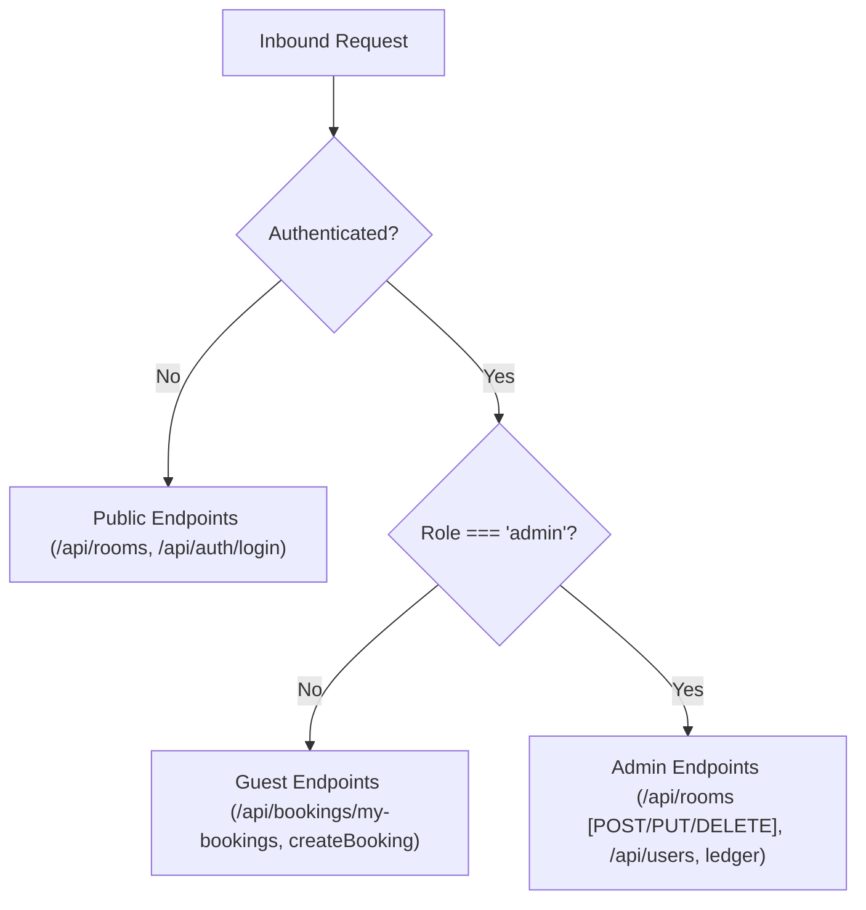

# Authentication & Access Control

## 1. Multi-Tier Access Control

HotelPro implements **Role-Based Access Control (RBAC)** across both frontend routes and backend API endpoints:

---

## 2. Access Matrix

| Resource / Action | Public | Authenticated Guest | Administrator |
| :--- | :---: | :---: | :---: |
| Browse Rooms (`GET /api/rooms`) | Yes | Yes | Yes |
| View Room Details (`GET /api/rooms/:id`) | Yes | Yes | Yes |
| Create Account / Login | Yes | Yes | Yes |
| Create Booking (`POST /api/bookings`) | No | Yes | Yes |
| View My Bookings (`GET /api/bookings/my-bookings`) | No | Yes | Yes |
| Cancel Own Booking (`DELETE /api/bookings/:id`) | No | Yes | Yes |
| Provision Suite (`POST /api/rooms`) | No | No | Yes |
| Edit / Delete Suite (`PUT/DELETE /api/rooms/:id`) | No | No | Yes |
| View Full Bookings Ledger (`GET /api/bookings`) | No | No | Yes |
| Update Any Booking Status (`PUT /api/bookings/:id/status`) | No | No | Yes |
| View / Promote Users (`GET/PUT /api/users`) | No | No | Yes |
| View 7 KPI Operations Cards (`/admin/overview`) | No | No | Yes |
